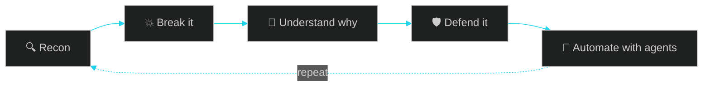

---

## 🛰️ OPERATOR PROFILE

<table>
<tr>
<td width="50%" valign="top">

**`IDENTITY`**

| | |
|---|---|
| **Name** | Aswathy P.S. |
| **Handle** | zenithVeil |
| **Base** | Kerala, India 🇮🇳 |
| **Education** | BTech CSE, Vidya Academy of Science & Technology (2028) |
| **Experience** | Infosys (EcoBazaarX) · ICT Academy, Infopark |

</td>
<td width="50%" valign="top">

**`ACTIVE OPERATIONS`**

| Op | Status |
|---|---|
| 🐞 Bug bounty research | 🟢 Active |
| 🚩 CTF competitions | 🟢 Active |
| 🛡️ AI security (LLM attacks & defenses) | 🟢 Active |
| 🤖 Security-focused agents | 🟢 Active |
| 🌐 Advanced web exploitation | 🟡 Learning |

</td>
</tr>
</table>

---

## 📡 OPERATING CYCLE

---

## 🧰 CAPABILITY MATRIX

| Domain | Coverage |
|---|---|
| 🔐 **Offensive Security** | Web app testing · CTFs · bug bounty methodology |
| 🧬 **AI Security** | Prompt injection · LLM app threat modeling |
| 🤖 **Agentic AI** | Autonomous agents · tool use · LLM pipelines |
| 🛠️ **Engineering** | Python tooling · automation · security scripts |

## 📶 CHANNEL STATUS

🟢 **Open to:** security internships · collaborations · open-source contributions

`github.com/zenithVeil`

 

*"The best defense is understanding the attack."*

